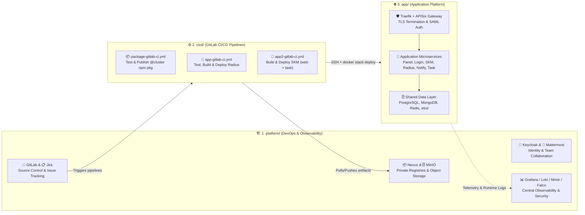

# 🐳 Swarm Platform Ecosystem


Welcome to the **Swarm Platform** repository! This repository serves as a complete, end-to-end engineering blueprint for building, automating, and running an on-premises container ecosystem powered by **Docker Swarm**.

It brings together **foundational DevOps & observability tooling**, **automated GitLab CI/CD pipelines**, and the **production application stack** into a single organized reference implementation.

---

## 🧭 Quick Navigation

Click on any module below to jump straight to its full documentation:

| Directory | Module Name | What It Covers | Documentation |
| :--- | :--- | :--- | :--- |
| 📁 [`platform/`](./platform/) | **Swarm Platform (DevOps & Core Tooling)** | Multi-node Swarm cluster hosting GitLab, Jira, Keycloak, Mattermost, Nexus, MinIO, Shared DBs, and the Grafana/Loki/Mimir/Falco observability stack. | 📖 [**Read Platform Docs →**](./platform/README.md) |
| 📁 [`app/`](./app/) | **Application Platform (Workload Stack)** | Customer-facing application services (`panel`, `login`, `SKM`, `notify`, `logging`, `radius`, `task`, `backup`), APISix SAML gateway, Traefik, and shared data stores. | 📖 [**Read Application Docs →**](./app/README.md) |
| 📁 [`cicd/`](./cicd/) | **CI/CD Pipelines (Automation)** | Reusable GitLab CI/CD pipeline definitions for testing, building, tagging, publishing npm packages/Docker images, and deploying to Swarm over SSH. | 📖 [**Read CI/CD Docs →**](./cicd/README.md) |

---

## 🔄 How Everything Fits Together

The three directories represent distinct stages of the platform lifecycle—from shared internal tooling, to continuous delivery, to the deployed customer-facing workloads:



---

## 📂 Directory Guide

### 🏗️ 1. [`platform/`](./platform/) — Foundational Swarm Platform
> 📖 **Full Guide:** [`platform/README.md`](./platform/README.md)

Turns existing Linux servers or virtual machines into a multi-node container platform with a single Swarm manager, dedicated worker nodes pinned via node labels, centralized TLS routing, and full-stack observability.

- **Core Infrastructure (`core/`):** Traefik reverse proxy, shared PostgreSQL, shared Redis, and [Keycloak IAM](./platform/core/keycloak/README.md).
- **DevOps & Collaboration Apps (`apps/`):** GitLab, Jira, [Mattermost](./platform/apps/mm/README.md), Nexus Repository, and MinIO object storage.
- **Observability & Security (`monitoring/`):** Grafana dashboards, Loki log aggregation, Mimir metrics, Alloy telemetry collector, and Falco runtime threat detection.
- **Quick Links:** [Architecture](./platform/README.md#architecture) • [Prerequisites](./platform/README.md#prerequisites) • [Node Labeling](./platform/README.md#node-labeling) • [Deployment](./platform/README.md#deployment)

---

### 🌐 2. [`app/`](./app/) — Application Platform
> 📖 **Full Guide:** [`app/README.md`](./app/README.md)

Deploys the production application suite and its supporting gateway/data layer onto a single-manager Docker Swarm cluster for on-premises customer environments.

- **Core Stack (`docker-compose-core.yml`):** Deploys Traefik, shared PostgreSQL, Redis, MongoDB, and the core microservices (`panel`, `login`, `skm`, `notify`, `logging`, `radius`, `task`, `backup`).
- **Gateway Stack (`docker-compose-gateway.yml`):** Deploys Apache APISix and `etcd` with custom Lua plugins (`saml-auth.lua`, `error-page.lua`) for SAML authentication and session management.
- **Operations Ready:** Includes SSL certificate generation commands, Swarm network tuning (`docker_gwbridge`), and database dump/restore runbooks.
- **Quick Links:** [Architecture](./app/README.md#architecture) • [Configuration](./app/README.md#configuration) • [Deployment](./app/README.md#deployment) • [APISix SAML Setup](./app/README.md#apisix-configuration) • [Backup & Restore](./app/README.md#backup-and-restore)

---

### ⚙️ 3. [`cicd/`](./cicd/) — GitLab CI/CD Pipelines
> 📖 **Full Guide:** [`cicd/README.md`](./cicd/README.md)

Contains production-grade GitLab CI/CD pipeline templates designed for air-gapped / private-registry environments where npm, Docker, Debian, and Alpine repositories are privately hosted.

- **`package-gitlab-ci.yml`:** Runs unit tests and publishes scoped Node.js packages (`@cluster`) to the private GitLab npm registry on the `main` branch.
- **`app-gitlab-ci.yml`:** End-to-end `test` → `build` → `deploy` pipeline for single-image web services (e.g., Radius).
- **`app2-gitlab-ci.yml`:** Multi-image `build` → `deploy` pipeline for services requiring both a web container and a background worker container (`Dockerfile.web` + `Dockerfile.task`, e.g., SKM).
- **Quick Links:** [Common Practices](./cicd/README.md#common-practices-across-all-pipelines) • [Branch-Driven Environments](./cicd/README.md#branch-driven-deployment-environments) • [Deployment Mechanism](./cicd/README.md#deployment-mechanism) • [Required CI Variables](./cicd/README.md#required-ci-variables-reference)

---

## 🗂️ Repository Map

```text
swarm-platform/
├── 📄 README.md                          # 👈 You are here (Repository Entrypoint)
│
├── 📁 platform/                          # 🏗️ Foundational DevOps & Observability Swarm Cluster
│   ├── 📖 README.md                      #    → Platform architecture, setup & deployment guide
│   ├── 🚀 deploy.sh / Makefile           #    → Single-command stack deployment
│   ├── ⚙️ env.example                    #    → Environment variable template
│   ├── 📁 core/                          #    → Traefik, PostgreSQL, Redis & Keycloak
│   │   └── 📁 keycloak/README.md         #      → Keycloak container reference links
│   ├── 📁 apps/                          #    → GitLab, Jira, Mattermost, Nexus & MinIO
│   │   └── 📁 mm/README.md               #      → Mattermost Docker reference guide
│   └── 📁 monitoring/                    #    → Grafana, Loki, Mimir, Alloy & Falco configs
│
├── 📁 app/                               # 🌐 Customer-Facing Application Swarm Stack
│   ├── 📖 README.md                      #    → Application stack deployment & operations guide
│   ├── 🐳 docker-compose-core.yml        #    → App services, Traefik & shared DBs stack
│   ├── 🐳 docker-compose-gateway.yml     #    → APISix gateway & etcd stack
│   ├── ⚙️ example.env                    #    → Application environment template
│   ├── 📁 apisix_conf/                   #    → APISix config & custom SAML/error Lua plugins
│   ├── 📁 init-scripts/                  #    → MongoDB initialization scripts
│   └── 📁 traefik/                       #    → Traefik static & TLS dynamic configuration
│
└── 📁 cicd/                              # ⚙️ GitLab CI/CD Pipeline Definitions
    ├── 📖 README.md                      #    → Pipeline patterns, tagging & variable reference
    ├── 📄 package-gitlab-ci.yml          #    → Private npm package test & publish pipeline
    ├── 📄 app-gitlab-ci.yml              #    → Single-image web app CI/CD pipeline (Radius)
    └── 📄 app2-gitlab-ci.yml             #    → Dual-image web + task CI/CD pipeline (SKM)
```

---

## 🚀 Where Should I Start?

1. **Setting up internal DevOps & monitoring infrastructure** (GitLab, Jira, Keycloak, Mattermost, Nexus, MinIO, Grafana/Loki)?
   👉 Start with the [**Swarm Platform README (`platform/README.md`)**](./platform/README.md).
2. **Deploying or operating the core product stack** (Panel, Login, SKM, Radius, APISix SAML gateway)?
   👉 Head over to the [**Application Platform README (`app/README.md`)**](./app/README.md).
3. **Configuring automated builds, private registries, and Swarm deployments in GitLab CI**?
   👉 Check out the [**CI/CD Pipelines README (`cicd/README.md`)**](./cicd/README.md).
