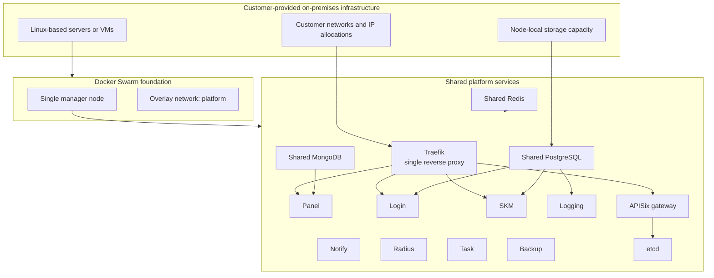

# Application Platform

A Docker Swarm–based, multi-node platform for running the application stack on customer-provided, on-premises infrastructure.

This project deploys the application (panel, authentication, SKM, notifications, logging, and supporting services) together with its shared data stores and a central reverse proxy onto a single-manager Docker Swarm cluster. It is intended for environments where the customer owns the infrastructure and network, and the platform operator is responsible for installing and configuring the cluster and its services.

> **Project status:** The platform is a reference implementation. Node counts, storage paths, network details, and image registries must be validated for each target environment.

## Contents

- [Goals and scope](#goals-and-scope)
- [Overview](#overview)
- [Architecture](#architecture)
- [Technology stack](#technology-stack)
- [High availability and cluster lifecycle](#high-availability-and-cluster-lifecycle)
- [Prerequisites](#prerequisites)
- [Configuration](#configuration)
- [Deployment](#deployment)
- [Platform components](#platform-components)
- [APISix configuration](#apisix-configuration)
- [Docker Swarm network configuration](#docker-swarm-network-configuration)
- [Backup and restore](#backup-and-restore)
- [Secrets and security](#secrets-and-security)
- [Commands](#commands)
- [Repository layout](#repository-layout)
- [Validation](#validation)
- [Roadmap](#roadmap)
- [License](#license)

## Goals and scope

The platform is intended for on-premises environments where the customer provides and administers the underlying infrastructure, while the platform operator installs and configures Docker Swarm and the application services.

The main design goals are:

- **On-premises first:** deploy onto customer-provided servers or virtual machines without depending on a particular hypervisor or cloud provider.
- **Single manager:** use one Swarm manager as the control point for service orchestration and shared infrastructure.
- **Central reverse proxy:** use Traefik as the single entrypoint for domain-based service access, with APISix providing gateway and SAML authentication capabilities.
- **Shared data services:** consolidate PostgreSQL, Redis, and MongoDB into shared instances used by the application services.
- **Pinned artifacts:** use explicit image versions rather than floating tags.
- **Clear ownership boundaries:** provide shared platform capabilities while leaving application-specific configuration to the application teams.

### What this project does

The project provides:

1. A Swarm initialization and cluster configuration workflow.
2. Shared PostgreSQL, Redis, and MongoDB services.
3. A central Traefik reverse proxy with TLS termination and domain routing.
4. The application services (panel, login, SKM, notify, logging, radius, task, backup).
5. An APISix gateway with SAML authentication support.
6. Backup and restore procedures for the shared databases.

### What this project does not do

The customer remains responsible for supplying the compute, network, IP allocations, and storage capacity. The project does not provision virtual machines, configure hypervisors, allocate customer networks, or manage the physical infrastructure lifecycle.

## Overview


## Architecture

The platform has three main layers:

1. **Customer infrastructure:** servers or virtual machines, network connectivity, IP allocations, and node-local storage capacity.
2. **Swarm foundation:** a single manager node and an attachable overlay network (`platform`).
3. **Shared platform services:** Traefik, shared PostgreSQL, Redis, and MongoDB, the application services, and the APISix gateway.

### Logical architecture



### Service placement

All services are pinned to the Swarm manager node:

| Stack | Services | Placement |
|---|---|---|
| `app` | Traefik, PostgreSQL, Redis, MongoDB, panel, notify, login, SKM, logging, radius, task, backup | `node.role == manager` |
| `swg` | etcd, APISix | `node.role == manager` |

## Technology stack

| Area | Technology |
|---|---|
| Cluster orchestration | Docker Swarm |
| Reverse proxy | Traefik |
| Databases | PostgreSQL, MongoDB (shared) |
| Cache | Redis (shared) |
| Gateway | APISix |
| Configuration store | etcd |
| Application services | Panel, login, SKM, notify, logging, radius, task, backup |
| Configuration | Environment variables, Docker Compose |

Versions are maintained in the compose files and `example.env`. Consult those files for the exact versions used by a particular repository revision.

## High availability and cluster lifecycle

The current implementation uses a **single manager**. This simplifies operation but means the manager is a single point of control. Worker nodes can be added or removed through standard Swarm join/leave operations, although all services are currently constrained to the manager node.

Redeployment is supported through `docker stack deploy`. Services declare restart policies and placement constraints to support repeatable execution. Validate changes in a representative environment before applying them to important workloads.

## Prerequisites

### Operating system and tooling

- **Linux-based servers** (no hard OS requirement; adjust paths and packages as needed).
- **Docker Engine** with Swarm mode enabled.
- SSH access with sufficient privileges from the deployment host to all nodes.
- `openssl` for certificate generation.
- `envman` for environment file generation (see [Update envs](#update-envs)).

### Infrastructure and network

The customer or infrastructure administrator must provide:

- One manager node.
- Network connectivity between nodes on the ports required by Swarm and the deployed services.
- Node IP addresses and SSH access information.
- A reserved domain and DNS records for service hostnames (`panel`, `login`, `skm`, and the apex domain).
- Node-local storage capacity for bind-mounted data volumes.

### Swarm ports

Ensure the following ports are reachable between nodes.

**Manager:**

Includes authentication and core servers.

- TCP 2377 — Swarm management
- TCP 7946 — Cluster gossip
- UDP 7946 — Cluster gossip
- UDP 7688 — Overlay network data plane

**Worker:**

Includes gateway and database servers.

- TCP 7946 — Cluster gossip
- UDP 7946 — Cluster gossip
- UDP 7688 — Overlay network data plane

## Configuration

Environment-specific settings are maintained in `example.env`. Copy it to `.env` (or the per-service env files consumed via `ENV_DIR`) and fill in values before deployment.

At a minimum, review:

| Configuration area | Responsibility |
|---|---|
| Domain and data path | Set `DOMAIN` and `DATA_PATH` |
| Swarm overlay network | Create the `platform` attachable overlay network |
| Shared PostgreSQL | Credentials and data path |
| Shared Redis | Password and data path |
| Shared MongoDB | Credentials and data path |
| Traefik | Domain and certificate storage |
| APISix | Upstream host and certificates |
| Service images | Registry path and deployment tag |

### Swarm initialization

Initialize the first **Core server** as the Swarm **manager node**.

**Command:**

```bash
docker swarm init \
  --default-addr-pool {{IP_RANGE}} \
  --default-addr-pool-mask-length {{SUBNET_MASK}} \
  --data-path-port 7688 \
  --advertise-addr {{PUBLIC_IP_MASTER}}
```

**Example:**

```bash
docker swarm init \
  --default-addr-pool 10.31.0.0/16 \
  --default-addr-pool-mask-length 24 \
  --data-path-port 7688 \
  --advertise-addr 192.0.2.100
```

After the first manager node is initialized, join the remaining nodes as **worker** or **manager** nodes according to the target architecture.

To retrieve the join command, run the appropriate command on the manager node, which is the Core server.

**Manager join token:**

```bash
docker swarm join-token manager
```

**Worker join token:**

```bash
# Worker
docker swarm join-token worker
```

> When joining a node, add the node-specific `--advertise-addr` value to the generated `docker swarm join` command.
> **Example:** `docker swarm join --advertise-addr {{TARGET_NODE_PUBLIC_IP}} --token {{TOKEN}} {{MASTER_PUBLIC_IP}}:2377`

### Mount volumes

SSH into the core server and create the required directory for saving data. After creating the directories, assign the correct ownership and permissions so the containers can read and write data properly.

```bash
sudo mkdir -p /data/{skm/uploads,traefik,postgres,mongo,redis/master,redis/replica,backup,etcd}
sudo chown -R ubuntu:ubuntu /data/*
```

### Create network

SSH into the Core server and create an attachable overlay network. This network will be used by the Swarm services and standalone containers that need to communicate with each other.

```bash
docker network create --attachable --driver overlay platform
```

### Create SSL certificates

```bash
# Platform certificate
openssl req -x509 -newkey rsa:4096 -sha256 -days 3650 -nodes \
  -keyout /data/traefik/key.pem -out /data/traefik/certificate.pem \
  -subj "/CN=demo.example.com" \
  -addext "subjectAltName=DNS:demo.example.com,DNS:*.demo.example.com" \
  -addext "basicConstraints=CA:FALSE"

# APISix upstream
openssl req -x509 -newkey rsa:4096 -sha256 -days 3650 -nodes \
  -keyout /data/traefik/exp-key.pem -out /data/traefik/exp-certificate.pem \
  -subj "/CN=example.com" \
  -addext "subjectAltName=DNS:example.com,DNS:*.example.com" \
  -addext "basicConstraints=CA:FALSE"

sudo chmod 444 /data/traefik/key.pem
sudo chmod 444 /data/traefik/exp-key.pem
```

### Update envs

```bash
./envman generate schema.yml -e .env
```

## Deployment

The expected deployment sequence is:

1. Initialize the Swarm on the manager node.
2. Join worker nodes to the Swarm (if any).
3. Create the attachable overlay network: `docker network create --attachable --driver overlay platform`
4. Create the required data directories on each node.
5. Copy `example.env` to `.env` and fill in values.
6. Load the environment: `set -a; . envs/.host.env; set +a`
7. Deploy the stacks.

### Running Swarm

Update the `.env` file with the required environment-specific values, then load the variables into the current shell session:

```bash
set -a; . envs/.host.env; set +a
```

Deploy the required Swarm stacks:

```bash
docker stack deploy --resolve-image never --compose-file docker-compose-core.yml app
docker stack deploy --resolve-image never --compose-file docker-compose-gateway.yml swg
```

### Single-command deployment

The `app` stack is deployed first, followed by the `swg` gateway stack. Re-running these commands redeploys the stacks with updated configuration.

## Platform components

### Traefik

Traefik is the single reverse proxy and TLS entrypoint. It uses the Swarm provider and routes services by domain name. HTTP requests are redirected to HTTPS. TLS certificates are loaded from the bind-mounted `/data/traefik` directory.

### Shared PostgreSQL

A single PostgreSQL instance backs the application services. Per-service users and databases are created through the initialization scripts.

### Shared Redis

A single Redis instance provides caching for the platform services.

### Shared MongoDB

A single MongoDB instance provides document storage for the application services.

### APISix

APISix is deployed as part of the gateway stack and provides gateway routing and SAML authentication. It uses etcd as its configuration store.

### application services

The `app` stack includes the panel, login, SKM, notify, logging, radius, task, and backup services. Each is constrained to the manager node and exposed through Traefik by domain where applicable.

## APISix configuration

### Update Traefik configs

- `docker-compose-gateway.yml` => APISix host
- `traefik/dynamic.yml` => certificates

### APISix add server

In the application panel, add the APISix domain, which is only reachable cluster-wide: `apisix.{{DOMAIN}}`

> Example: `apisix.demo.example.com`

### Serverless script example

```lua
local core = require("apisix.core")
local session = require("resty.session")
local cjson = require("cjson.safe")

return function(conf, ctx)

    local sess = session.start({
        storage = "shm",
        cookie_name = "saml_session",

        -- MUST match resty.saml set by SKM
        secret = "SECRET",
    })

    if not sess then
        core.log.error("session.start() returned nil")
        return
    end

    core.log.error("========== SAML SESSION ==========")

    local authenticated = sess:get("authenticated")
    local name_id        = sess:get("name_id")
    local session_index  = sess:get("session_index")
    local issuer         = sess:get("issuer")
    local expires        = sess:get("expires")
    local attrs          = sess:get("attrs")

    core.log.error("authenticated : ", tostring(authenticated))
    core.log.error("name_id        : ", tostring(name_id))
    core.log.error("session_index  : ", tostring(session_index))
    core.log.error("issuer         : ", tostring(issuer))
    core.log.error("expires        : ", tostring(expires))

    if attrs then
        local encoded = cjson.encode(attrs)
        core.log.error("attrs: ", encoded or "<encode failed>")

        -- Example:
        -- local email = attrs.email and attrs.email[1]
        -- local groups = attrs.groups
    else
        core.log.error("attrs: nil")
    end
end
```

### Rewrite script

```html
</head><script src=""></script>
```

## Docker Swarm network configuration

### Configure host Docker daemon

```json
// /etc/docker/daemon.json
{
  "bip": "10.30.0.1/16",
  // other configs ...
}
```

### Configure `docker_gwbridge` interface

> This must be done **before** running `docker swarm init` or `docker swarm join`.

```bash
# if already exists (all commands)
sudo systemctl stop docker.socket
sudo systemctl stop docker

sudo brctl show docker_gwbridge
sudo ip link set docker_gwbridge down
sudo brctl delbr docker_gwbridge

sudo systemctl start docker

docker network rm docker_gwbridge

# if it does not exist
docker network create \
  --driver bridge \
  --subnet 10.33.0.0/16 \
  --opt com.docker.network.bridge.name=docker_gwbridge \
  --opt com.docker.network.bridge.enable_icc=false \
  --opt com.docker.network.bridge.enable_ip_masquerade=true \
  docker_gwbridge
```

### Configure Docker Swarm CIDR

```bash
# bridge
docker swarm init \
  --default-addr-pool 10.31.0.0/16 \
  --default-addr-pool-mask-length 24 \
  --data-path-port 7688 \
  --advertise-addr 192.0.2.100
```

## Backup and restore

First open the proper ports: `27017` for MongoDB and `5432` for PostgreSQL.

### MongoDB

Inside the MongoDB container, run these commands:

```bash
# Dump
mongodump \
  --host 127.0.0.1 \
  --port 27017 \
  --username root \
  --password "password" \
  --authenticationDatabase admin \
  --db platform \
  --out backup \
  --gzip


# Restore
docker cp ../mongo-seed {{MONGO_CONTAINER_ID}}:/backup
mongorestore \
  --host 127.0.0.1 \
  --port 27017 \
  --username root \
  --password password \
  --authenticationDatabase admin \
  --db platform \
  --gzip \
  --drop \
  --dir ./backup/platform/  # must include full path to bson files
```

### PostgreSQL

Inside the PostgreSQL container, run these commands _(temporarily comment `user: postgres`)_:

```bash
# Dump
pg_dump \
  --host="192.0.2.10" \
  --port="5432" \
  --username="postgres" \
  --dbname="logging" \
  --format="custom" \
  --verbose \
  --password \
  --file="./postgres-backup.dump"

# Restore
pg_restore \
  --host="127.0.0.1" \
  --port="5432" \
  --username="postgres" \
  --dbname="logging" \
  --verbose \
  --password \
  ./postgres-backup.dump

# Permissions
sudo chown 70:70 -R /data/postgres/
```

## Secrets and security

- Credentials are provided through environment variables loaded from `.env` and the per-service env files.
- Do not commit `.env` or secret material to version control.
- Traefik terminates TLS for HTTP services.
- Services drop capabilities and enable `no-new-privileges` where applicable.

Protect secret material according to the customer's security procedures.

## Commands

### Nodes

- `docker node ls` — Swarm nodes status

### Services

- `docker stack ls` — list running stacks
- `docker stack services {{STACK_NAME}}` — list running services in the stack
- `docker stack ps {{STACK_NAME}}` — list container status in the stack
- `docker stack rm {{STACK_NAME}}` — destroy stack

## Repository layout

```text
.
├── apisix_conf/
│   ├── config.yml
│   ├── docker-entrypoint.sh
│   └── plugins/
│       ├── error-page.lua
│       └── saml-auth.lua
├── docker-compose-core.yml
├── docker-compose-gateway.yml
├── example.env
├── init-scripts/
│   └── login-init-mongo.js
├── traefik/
│   ├── dynamic.yml
│   └── traefik.yml
└── README.md
```

## Validation

After deployment, check cluster and service state:

```bash
docker node ls
docker stack ls
docker stack services app
docker stack services swg
```

For Traefik routing, verify that each service domain resolves and returns the expected application.

## Roadmap

Potential areas for future development include:

- Multi-manager high availability.
- Automated backup and restore procedures.
- Additional storage integrations.
- Expanded monitoring and alerting.
- Further security hardening and secret-management automation.

These are planned or potential improvements, not claims about currently implemented functionality.

## License

See [LICENSE](LICENSE) for the license governing this project.
