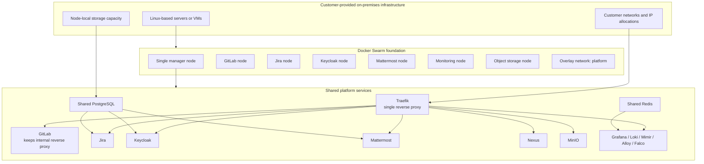

# Swarm Platform

A Docker Swarm–based, multi-node platform reference implementation for on-premises infrastructure.

This project turns existing Linux-based servers or virtual machines into a container platform with a single manager, dedicated service nodes, shared data services, a central reverse proxy, and foundational observability. It is designed for environments where the customer owns the infrastructure and network, and the platform operator is responsible for installing and configuring the Swarm cluster and its shared services.

The repository is both a working implementation and an adaptable engineering reference. It does not provision virtual machines, depend on a particular hypervisor, or provide a complete managed container distribution.

> **Project status:** The platform is a reference implementation. Node counts, service placement, storage paths, and network details must be validated for each target environment.

## Contents

- [Goals and scope](#goals-and-scope)
- [Overview](#overview)
- [Architecture](#architecture)
- [Technology stack](#technology-stack)
- [High availability and cluster lifecycle](#high-availability-and-cluster-lifecycle)
- [Prerequisites](#prerequisites)
- [Configuration](#configuration)
- [Deployment](#deployment)
- [Platform components](#platform-components)
- [Secrets and security](#secrets-and-security)
- [Logging and observability](#logging-and-observability)
- [Application team responsibilities](#application-team-responsibilities)
- [Repository layout](#repository-layout)
- [Validation](#validation)
- [Roadmap](#roadmap)
- [License](#license)

## Goals and scope

The platform is intended for on-premises environments where the customer provides and administers the underlying infrastructure, while the platform operator installs and configures Docker Swarm and its foundational services.

The main design goals are:

- **On-premises first:** deploy onto customer-provided virtual machines or servers without depending on a particular hypervisor or cloud provider.
- **Single manager:** use one Swarm manager as the control point for service orchestration and shared infrastructure.
- **Dedicated service nodes:** pin each major service to a specific worker node through node labels.
- **Central reverse proxy:** use Traefik as the single entrypoint for domain-based service access.
- **Shared data services:** consolidate repeated technologies (PostgreSQL, Redis) into shared instances.
- **Pinned artifacts:** use explicit image versions rather than floating tags.
- **Clear ownership boundaries:** provide shared platform capabilities while leaving application-specific deployment and lifecycle management to application teams.

### What this project does

The project provides:

1. A Swarm initialization and node-labeling workflow.
2. Shared PostgreSQL and Redis services.
3. A central Traefik reverse proxy with TLS termination and domain routing.
4. Application and platform services (GitLab, Jira, Keycloak, Mattermost, Nexus, MinIO, monitoring).
5. A single-command deployment entry point.

### What this project does not do

The customer remains responsible for supplying the compute, network, IP allocations, and storage capacity. The project does not provision VMs, configure hypervisors, allocate customer networks, or manage the physical infrastructure lifecycle. It also does not deploy or operate application-specific workloads.

## Overview


## Architecture

The platform has three main layers:

1. **Customer infrastructure:** VMs or physical servers, network connectivity, IP allocations, and node-local storage capacity.
2. **Swarm foundation:** a single manager node, worker nodes, and an attachable overlay network.
3. **Shared platform services:** Traefik, shared PostgreSQL, shared Redis, application services, and observability.

### Logical architecture



### Service placement

Each service is pinned to a dedicated node through node labels:

| Stack | Services | Node label |
|---|---|---|
| `core` | Traefik, PostgreSQL, Redis | `server=manager` |
| `core` | Keycloak | `server=keycloak` |
| `apps` | GitLab | `server=gitlab` |
| `apps` | Jira | `server=jira` |
| `apps` | Mattermost | `server=mattermost` |
| `apps` | Nexus, MinIO | `server=object-storage` |
| `monitoring` | Grafana, Loki, Mimir, Alloy | `server=monitoring` |
| `monitoring` | Falco (global) | worker nodes |

## Technology stack

| Area | Technology |
|---|---|
| Cluster orchestration | Docker Swarm |
| Reverse proxy | Traefik |
| Databases | PostgreSQL (shared) |
| Cache | Redis (shared) |
| Identity | Keycloak |
| Source control | GitLab |
| Issue tracking | Jira |
| Collaboration | Mattermost |
| Artifact storage | Nexus |
| Object storage | MinIO |
| Observability | Grafana, Loki, Mimir, Alloy, Falco |
| Configuration | Environment variables, Docker Compose |

Versions are maintained in the compose files and `env.example`. Consult those files for the exact versions used by a particular repository revision.

## High availability and cluster lifecycle

The current implementation uses a **single manager**. This simplifies operation but means the manager is a single point of control. Worker nodes can be added or removed through standard Swarm join/leave operations.

Redeployment is supported through `docker stack deploy`. Services declare restart policies and placement constraints to support repeatable execution. Validate changes in a representative environment before applying them to important workloads.

## Prerequisites

### Operating system and tooling

- **Linux-based servers** (no hard OS requirement; adjust paths and packages as needed).
- **Docker Engine** with Swarm mode enabled.
- SSH access with sufficient privileges from the deployment host to all nodes.

### Infrastructure and network

The customer or infrastructure administrator must provide:

- One manager node.
- Worker nodes for GitLab, Jira, Keycloak, Mattermost, monitoring, and object storage.
- Network connectivity between nodes on the ports required by Swarm and the deployed services.
- Node IP addresses and SSH access information.
- A reserved domain and DNS records for service hostnames.
- Node-local storage capacity for bind-mounted data volumes.

### Swarm ports

Ensure the following ports are reachable between nodes:

- TCP 2377 — Swarm management
- TCP/UDP 7946 — Cluster gossip
- UDP 7688 (or 4789) — Overlay network data plane

## Configuration

Environment-specific settings are maintained in `env.example`. Copy it to `.env` and fill in values before deployment.

At a minimum, review:

| Configuration area | Responsibility |
|---|---|
| Domain and data path | Set `DOMAIN` and `DATA_PATH` |
| Node labels | Label each node with its `server` role |
| Shared PostgreSQL | Credentials and data path |
| Shared Redis | Password and data path |
| Service credentials | Keycloak, MinIO, Grafana admin passwords |
| Service data paths | Per-service persistent storage locations |
| Traefik | Domain and certificate storage |

### Node labeling

After joining nodes to the Swarm, label them:

```bash
docker node update --label-add server=manager <manager-node>
docker node update --label-add server=gitlab <gitlab-node>
docker node update --label-add server=jira <jira-node>
docker node update --label-add server=keycloak <keycloak-node>
docker node update --label-add server=mattermost <mattermost-node>
docker node update --label-add server=monitoring <monitoring-node>
docker node update --label-add server=object-storage <object-storage-node>
```

## Deployment

The expected deployment sequence is:

1. Initialize the Swarm on the manager node.
2. Join worker nodes to the Swarm.
3. Create the attachable overlay network: `docker network create --attachable --driver overlay platform`
4. Label nodes as described above.
5. Create required data directories on each node.
6. Copy `env.example` to `.env` and fill in values.
7. Load the environment: `set -a; . .env; set +a`
8. Build the Keycloak image: `docker build -t rsa-kc:26.7.3 core/keycloak/`
9. Deploy: `./deploy.sh` (or `make deploy`)

### Single-command deployment

```bash
./deploy.sh
```

This deploys the `core`, `apps`, and `monitoring` stacks in order.

## Platform components

### Traefik

Traefik is the single reverse proxy and TLS entrypoint. It uses the Swarm provider and routes services by domain name. HTTP requests are redirected to HTTPS.

### Shared PostgreSQL

A single PostgreSQL instance hosts databases for Jira, Keycloak, and Mattermost. Per-service users and databases are created by an init script.

### Shared Redis

A single Redis instance provides caching for monitoring components.

### GitLab

GitLab keeps its own internal reverse proxy (the one exception). It is reachable through Traefik by domain while retaining its internal nginx.

### Jira

Jira is Traefik-fronted and uses the shared PostgreSQL database.

### Keycloak

Keycloak uses TCP passthrough through Traefik on port 8443 and the shared PostgreSQL database.

### Mattermost

Mattermost is Traefik-fronted, uses the shared PostgreSQL database, and publishes its calls ports for real-time communication.

### Nexus and MinIO

Nexus and MinIO provide artifact and object storage. Both are Traefik-fronted by domain.

### Monitoring

Grafana, Loki, Mimir, Alloy, and Falco provide logging, metrics storage, and runtime security monitoring.

## Secrets and security

- Credentials are provided through environment variables loaded from `.env`.
- Do not commit `.env` or secret material to version control.
- Traefik terminates TLS for HTTP services; Keycloak uses TCP passthrough.
- Services drop capabilities and enable `no-new-privileges` where applicable.
- Falco provides runtime threat detection on worker nodes.

Protect secret material according to the customer's security procedures.

## Logging and observability

The current observability path uses:

- **Grafana** for dashboards.
- **Loki** for log aggregation.
- **Mimir** for metrics storage.
- **Alloy** for telemetry collection.
- **Falco** and **Falcosidekick** for runtime security events.

## Application team responsibilities

The platform provides shared infrastructure capabilities so application teams can focus on their workloads.

| Platform responsibilities | Application team responsibilities |
|---|---|
| Swarm cluster foundation | Application images and manifests |
| Central reverse proxy and TLS | Application routes and exposure requirements |
| Shared PostgreSQL and Redis | Application data persistence requirements |
| Basic monitoring foundation | Application-specific monitoring configuration |
| Baseline runtime security | Application-specific security configuration |

The customer remains responsible for the underlying infrastructure, network, storage capacity, and infrastructure-level backup and recovery strategy.

## Repository layout

```text
.
├── core/
│   ├── docker-compose.yml
│   ├── traefik/
│   ├── postgres/
│   │   └── init/
│   └── keycloak/
├── apps/
│   ├── docker-compose.yml
│   └── mm/
├── monitoring/
│   ├── docker-compose.yml
│   └── monitoring/
├── docker-compose.yml
├── deploy.sh
├── Makefile
├── env.example
└── README.md
```

### `core/`

Contains the core infrastructure stack: Traefik, shared PostgreSQL, shared Redis, and Keycloak.

### `apps/`

Contains application-facing services: GitLab, Jira, Mattermost, Nexus, and MinIO.

### `monitoring/`

Contains the observability stack: Grafana, Loki, Mimir, Alloy, and Falco.

## Validation

After deployment, check cluster and service state:

```bash
docker node ls
docker stack ls
docker stack services core
docker stack services apps
docker stack services monitoring
```

For Traefik routing, verify that each service domain resolves and returns the expected application.

## Roadmap

Potential areas for future development include:

- Multi-manager high availability.
- Automated backup and restore procedures.
- Additional storage integrations.
- Expanded monitoring and alerting.
- Further security hardening and secret-management automation.

These are planned or potential improvements, not claims about currently implemented functionality.

## License

See [LICENSE](LICENSE) for the license governing this project.
